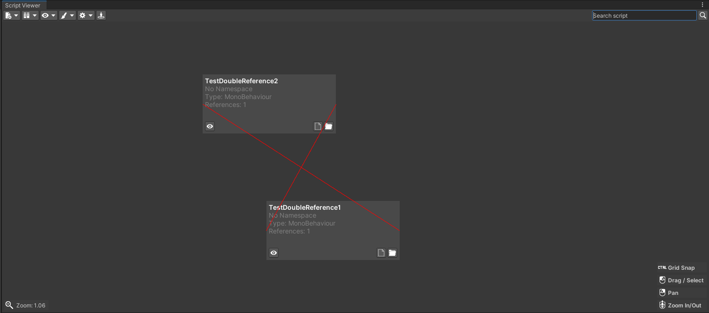
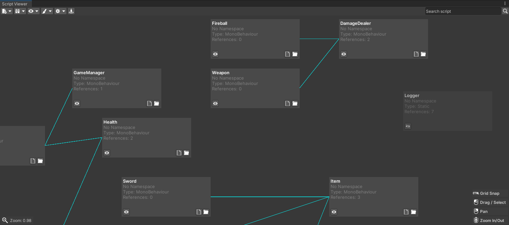
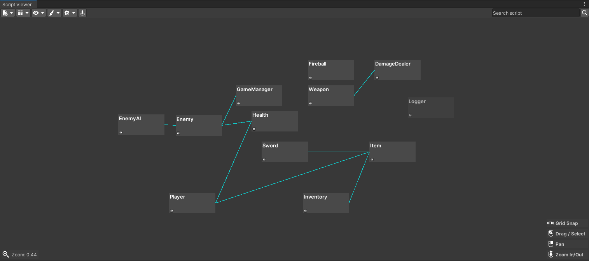

---
tags:
  - Unity
  - C#
  - Editor Tool
---

# Script Dependency Viewer

## Overview
Script Dependency Viewer is a Unity Editor tool that draws an interactive map of every C# script in a project's Assets folder. Each script is a movable, clickable node showing its name and namespace, laid out in a drag-and-zoom workspace.

Nodes can be coloured, edited live and used to jump straight to the code, which makes large or modular projects much easier to understand and maintain.

## What I Built
- A custom Editor window with a pannable, zoomable canvas.
- Automatic discovery of all scripts in the project, with name and namespace parsing.
- Node interactions: drag, select, colour-code and navigate to the script.
- Packaging and submission to the Unity Asset Store, following its publishing guidelines.

## Links
- [Unity Asset Store](https://assetstore.unity.com/packages/tools/gui/script-dependency-viewer-317391)

## Media

  <button class="prev" aria-label="Previous image">&larr;</button>
  
  
  
  
  <button class="next" aria-label="Next image">&rarr;</button>
  

