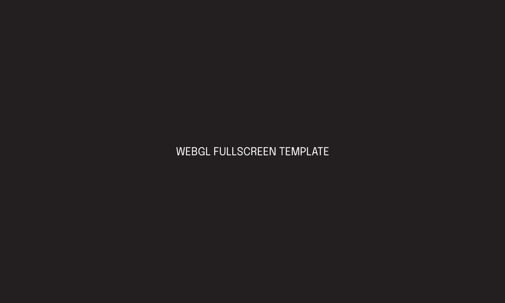

---
tags:
  - Unity
  - WebGL
  - HTML/CSS
---

# WebGL Fullscreen Template

## Overview
A lightweight Unity WebGL template that makes the build canvas resize to fill the browser window, instead of Unity's default fixed-size frame.

## What I Built
- A custom WebGL template (HTML/CSS/JS) that scales the Unity canvas responsively with the browser window.
- A drop-in package: import it, select the template in Player Settings, and build.
- Published to the Unity Asset Store, which meant working through Unity's packaging and review guidelines.

## Links
- [Unity Asset Store](https://assetstore.unity.com/packages/tools/utilities/webgl-fullscreen-template-243280)

## Media

  

