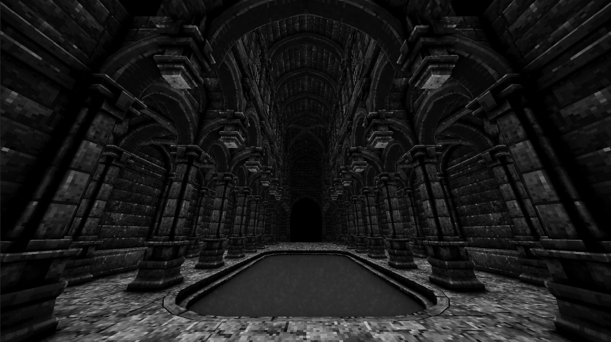
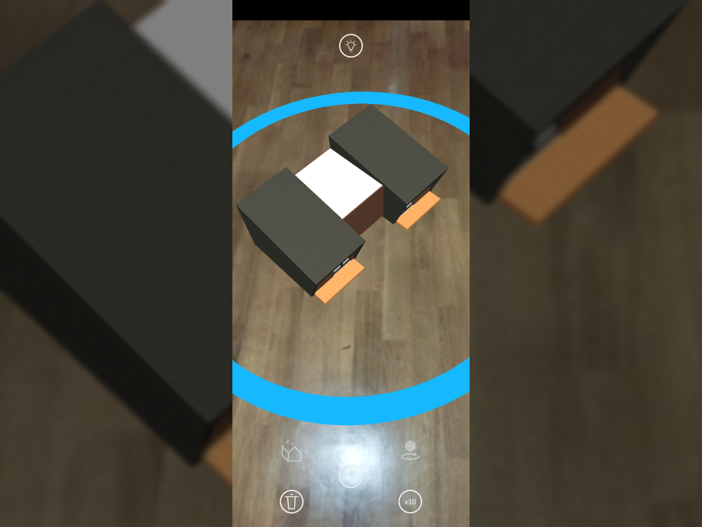

# João Santos

Unity Game Developer · AR/VR Engineer · Technical Lead

I build games and immersive AR/VR experiences in Unity, from the first prototype to the store release. Over **6+ years** I have shipped titles for **mobile (iOS & Android)**, **WebGL** and **standalone VR (Quest, HTC Vive)**.

[Get in touch :material-email:](mailto:joaosantosprofi@protonmail.com){ .md-button .md-button--primary }
[Interactive Portfolio :material-gamepad-variant:](interactive-portfolio.md){ .md-button }

## Featured Work

-   { loading=lazy }

    **[BlackBlood](projects/personal/black-blood.md)** · *Solo, in development*

    A fast, stylish PC action game that combines DOOM-style gunplay with Devil May Cry combos. 350+ C# files, designed and built solo.

-   { loading=lazy }

    **[Mower Mayhem](projects/professional/fisipgroup/mower-mayhem.md)** · *Lead Developer*

    Casual mobile racer shipped to the App Store and Google Play. I led the team and integrated ads, analytics, IAP and leaderboards.

-   { loading=lazy }

    **[Ooty AR](projects/professional/hivolve/ooty.md)** · *Unity Developer*

    Cross-platform AR app (ARKit + ARCore) for placing modular houses at real scale, with an in-app house editor.

-   { loading=lazy }

    **[KendirStudios](projects/professional/kendir-studios/about-kendir-studios.md)** · *Architecture Director*

    Large educational RPGs for the Portuguese Directorate-General for Education. I own architecture, internal Unity packages and team standards.

## Skills

- **Engine & Language:** Unity, C#, Unity Editor tooling, custom Unity packages
- **XR:** Meta/Oculus SDK, SteamVR, Google VR, ARKit, ARCore, Vuforia
- **Platforms:** iOS, Android, WebGL, Meta Quest, HTC Vive, PC
- **Live services:** GameAnalytics, IronSource, Unity IAP, Unity Leaderboards, AWS, backend API integration
- **Engineering:** Profiling & optimization, modular architecture, team leadership, Scrum

## About This Portfolio
Projects are grouped by company, newest first, with my role, the technical problems and what I built to solve them on each page. You can also [browse by tag](tags.md) (for example, every VR or AR project).

## Contact
- :material-email: [joaosantosprofi@protonmail.com](mailto:joaosantosprofi@protonmail.com)
- :fontawesome-brands-github: [GitHub](https://github.com/kronousTech)
- :fontawesome-brands-linkedin: [LinkedIn](https://www.linkedin.com/in/joão-santos-104182189)
- :simple-upwork: [Upwork](https://www.upwork.com/freelancers/~0123e3d22d308b137c)
- :fontawesome-brands-discord: [BlackBlood Discord community](https://discord.gg/g3Rx4kWm7j)
