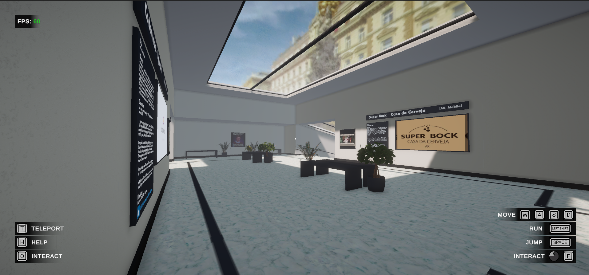
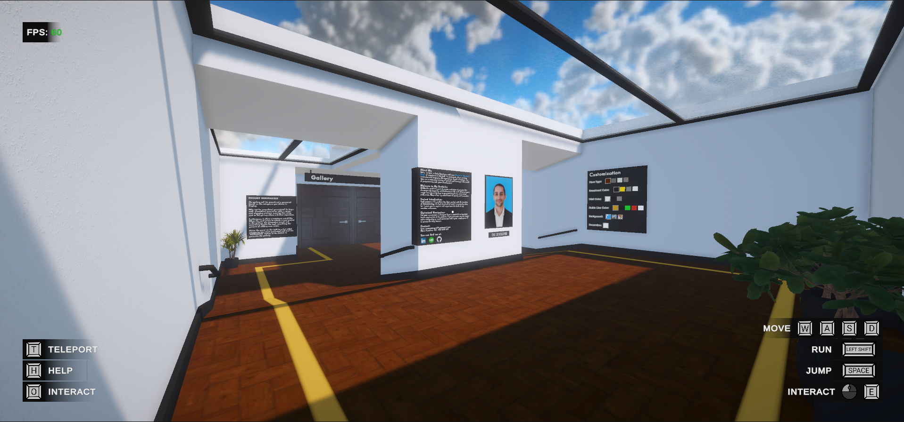
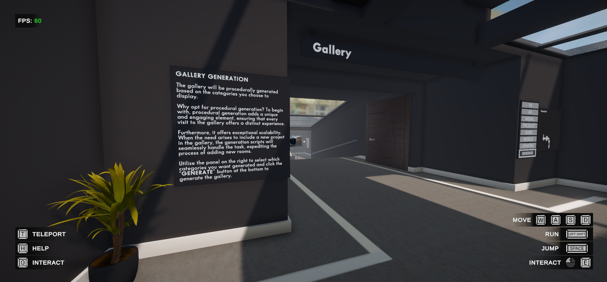

---
tags:
  - Unity
  - C#
  - WebGL
  - Procedural Generation
---

# Interactive Portfolio

## Overview
A playable version of this portfolio, built in Unity for WebGL. You walk through a 3D gallery where each room shows one project, from my early programming work to recent releases.

## Procedural Generation
The gallery is generated procedurally from the project categories you choose to display.

- **Every visit is different.** The layout is built at runtime, so the gallery changes with your selection.
- **It scales.** Adding a project only means adding its data. The generation scripts build the new room automatically, with no manual level editing.

## Links
- [Play the WebGL build](https://kronoustech.github.io/Portfolio-WEBGL-Build/)
- [Source code on GitHub](https://github.com/kronousTech/Portfolio-WEBGL-UnityProject)

## Media

  <button class="prev" aria-label="Previous image">&larr;</button>
  
  
  
  <button class="next" aria-label="Next image">&rarr;</button>
  

