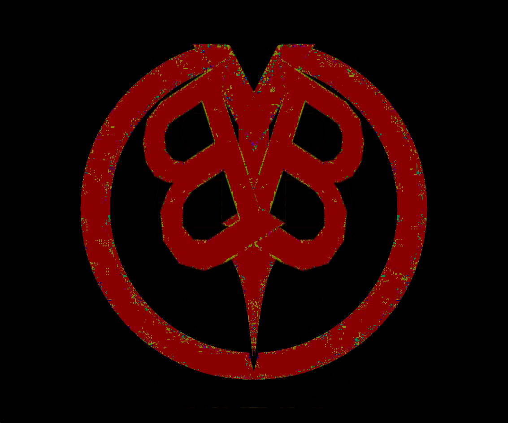
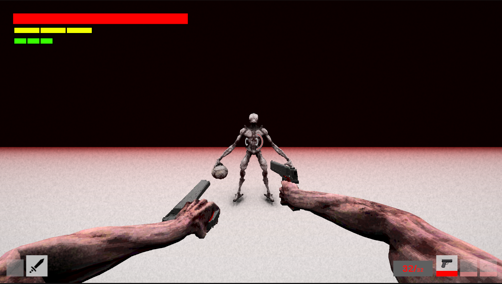
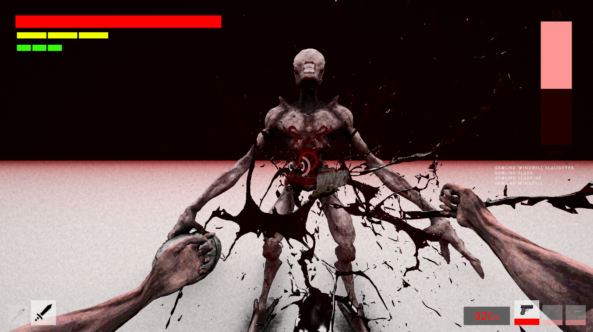

---
tags:
  - Unity
  - C#
  - PC
  - Game
---

# BlackBlood
***Fast. Stylish. Unforgiving.***

**Role:** Solo Developer · **Status:** In active development · **Scale:** 350+ C# files

## Overview
BlackBlood combines the gunplay of DOOM with the flashy combos of Devil May Cry. You survive intense combat arenas by constantly switching weapons and mixing melee and ranged attacks, and a live style rank rewards you for doing it well.

## Features
- Seamless gun and melee combat, with switching mid-combo
- Dynamic style ranking (D / C / B / A / S tiers)
- Parkour movement: dash, wall-run and swing
- Multiple melee and ranged weapons
- More systems in progress

## What I Built
I design, program and produce the whole game myself, including the combat, movement, weapon and style-ranking systems and the architecture that keeps a 350+ file codebase maintainable as a solo developer.

<!--
  TIP: this is your strongest page because you can talk about everything.
  Consider adding a "Technical Highlights" section with 3-4 bullets, e.g.:
  - How the combat/combo system is structured (state machine? data-driven weapons via ScriptableObjects?)
  - How the style rank is calculated (decay, variety bonus, damage-taken penalty)
  - How movement abilities are composed
  - How you keep the codebase modular (assemblies, events, packages)
  A short gameplay video here would also help a lot.
-->

## Links
- [🖥️ Download the latest tester build](https://github.com/kronousTech/BlackBlood-TestersBuild/releases/latest)
- [🎮 Join the Discord community](https://discord.gg/g3Rx4kWm7j)

## Media

  <button class="prev" aria-label="Previous image">&larr;</button>
  
  
  
  
  <button class="next" aria-label="Next image">&rarr;</button>
  

