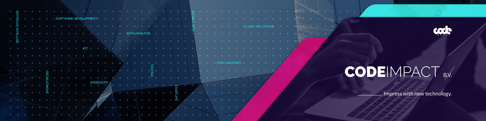

# CodeImpact

  

**2023 · Unity Developer**

CodeImpact is a Netherlands-based software and recruitment agency that builds custom software for clients across many industries, including game development, VR and XR.

- [LinkedIn](https://www.linkedin.com/company/codeimpact/)
- [Website](https://www.codeimpact.nl)

## My Experience
- Developed **VR** and **game** applications for the **Oculus Quest**.
- Modified the **Oculus Integration API** to improve the functionality of specific game features.
- Used **profiling tools** to find and fix complex behavioural and performance issues.
- Built and maintained **custom Unity packages** to speed up and simplify development.

## Projects
- [Drone Strike VR](drone-strike-vr.md)
- [Drum Keyboard VR](drum-keyboard.md)
