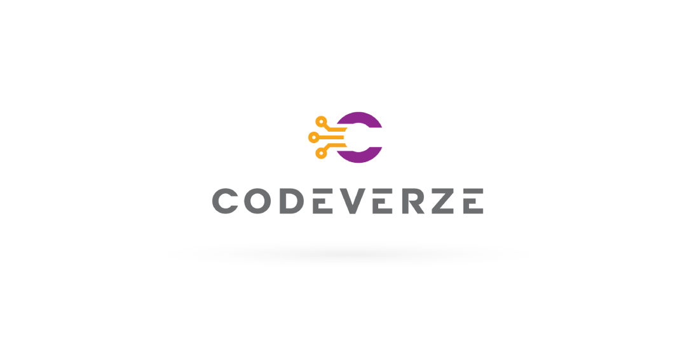

# Codeverze

  

**2022 - 2024 · Unity Developer**

<!-- TIP: if this role ran in parallel with FisipGroup/CodeImpact, say so here (e.g. "Contract" or "Part-time") so the overlapping dates don't raise questions. -->

Codeverze is a product of Meridian Pulse, a web and mobile development agency building e-commerce and large-scale applications for its clients.

- [LinkedIn](https://www.linkedin.com/company/meridian-pulse/)
- [Meridian Pulse website](https://meridianpulse.com)
- [Codeverze website](https://codeverze.com)

## My Experience
- Developed the frontend of **WebGL** applications.
- Integrated the backend **API**, connecting the Unity frontend to the platform's data.
- Collaborated with artists on the application's UI.

## Projects
- [Virtual Store](virtual-store.md)
