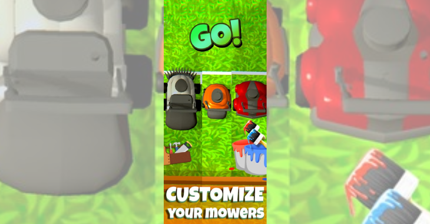
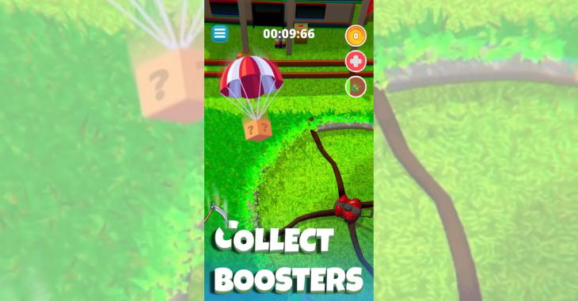
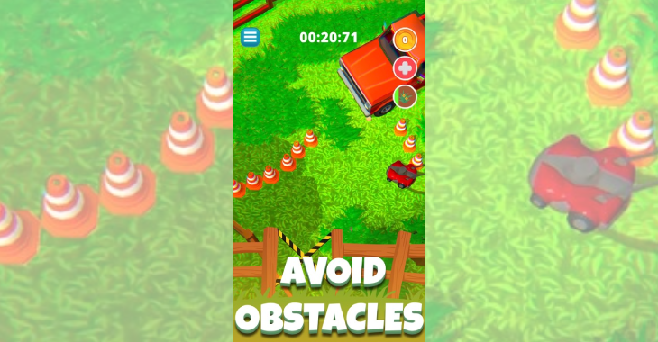
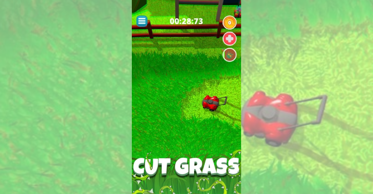

---
tags:
  - Unity
  - C#
  - iOS
  - Android
  - Game
  - Leadership
---

# Mower Mayhem

**Role:** Lead Unity Developer / Team Manager

## Overview
Mower Mayhem is a casual mobile racing game: clear the grass on each level and race to the finish line as fast as you can. It was built in Unity and shipped on Android and iOS.

- [Google Play](https://play.google.com/store/apps/details?id=com.FisipGroup.MowerMayhem)
- [App Store](https://apps.apple.com/mt/app/mower-mayhem-cut-to-the-chase/id6502991236)

## Challenge
This was a production game with a large, growing codebase that I had to maintain, extend and take through store release, while also leading the team building it.

## What I Did
- **Led the team:** coordinated programmers and artists, ran Scrum with an incremental MVP, and was the main technical contact for the project owner.
- **Built the level pipeline:** a custom Unity Editor tool so levels could be authored quickly without touching code.
- **Integrated live services:**
    - Analytics: GameAnalytics
    - Ads: IronSource
    - Leaderboards and in-app purchases: Unity Services
- **Kept it maintainable:** careful planning, consistent testing and incremental feature iteration let the project keep growing without falling apart, all the way to release on both stores.

## Media

  <button class="prev" aria-label="Previous image">&larr;</button>
  
  
  
  
  <button class="next" aria-label="Next image">&rarr;</button>
  

### Gameplay
<video controls preload="metadata" width="100%">
  <source src="../../../../content/projects/fisipgroup/mower-mayhem/gameplay.mp4" type="video/mp4">
</video>
