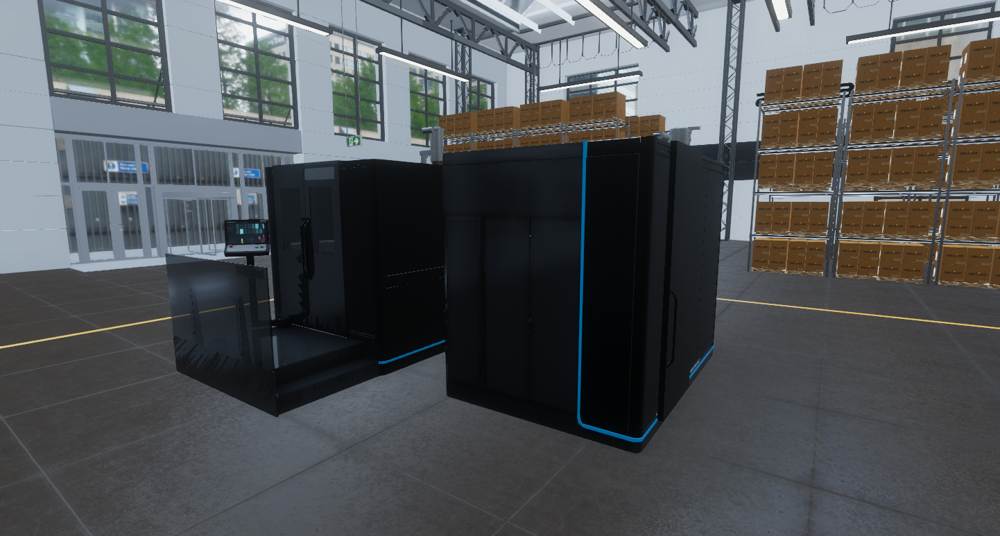
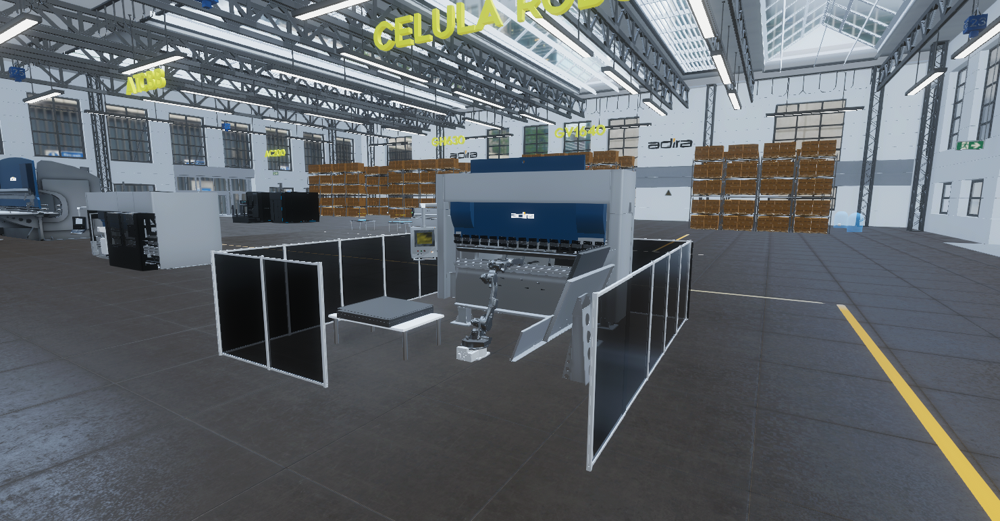
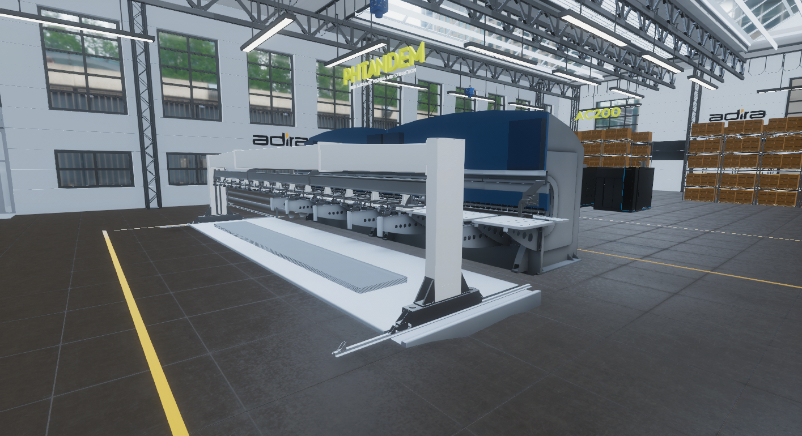
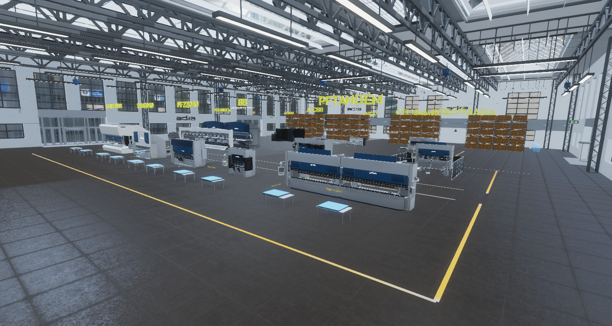

---
tags:
  - Unity
  - C#
  - VR
  - Meta Quest
  - Android
  - Optimization
---

# Adira VR

**Role:** Unity Developer

## Client
ADIRA is a global manufacturer of sheet-metal working machinery: laser cutters, hydraulic press brakes, shears, robotic bending cells and automated sheet-metal systems.

- [LinkedIn](https://www.linkedin.com/company/adirametalformingsolutions/)

## Overview
An interactive VR showcase of the client's machinery. Animated sequences show the machines working, and users can interact with them to learn how the production process works.

## Technologies
The project started on HTC Vive with the **SteamVR SDK**. Midway through, we moved to standalone **Oculus Quest 2** and switched to the **Oculus plugin**.

## Challenge
The machine models were highly complex, and moving to standalone Quest hardware made performance a serious problem.

## What I Did
- Created **LOD chains** for the heavy machine models.
- Tuned quality settings for the Quest.
- Together, these brought the experience to a consistent frame rate throughout.

## Media

  <button class="prev" aria-label="Previous image">&larr;</button>
  
  
  
  
  <button class="next" aria-label="Next image">&rarr;</button>
  

