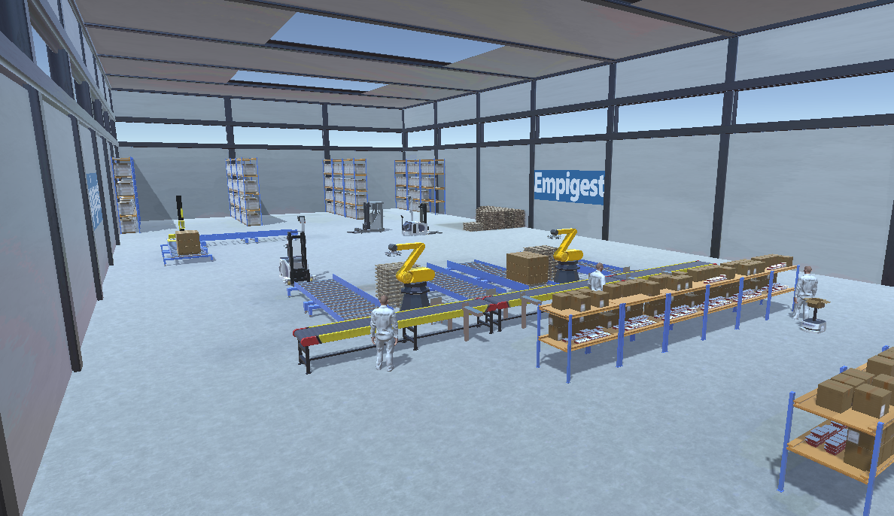
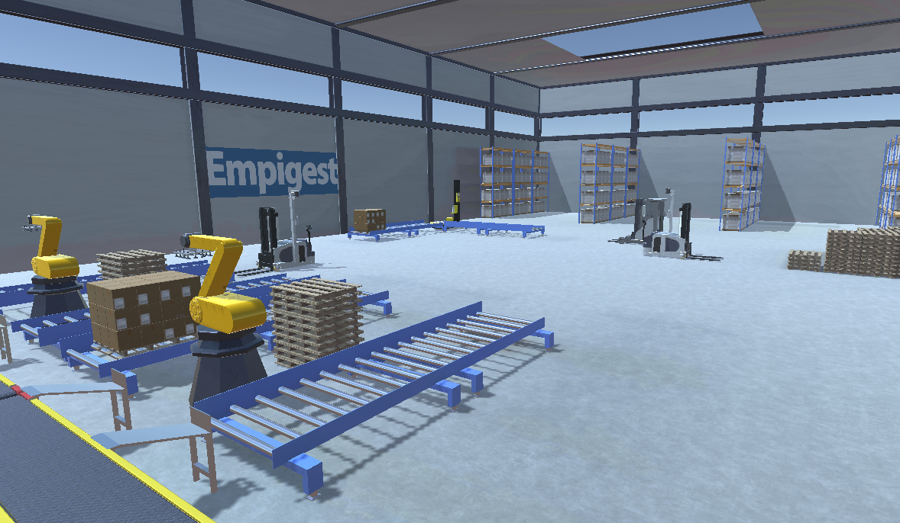

---
tags:
  - Unity
  - C#
  - VR
  - Android
---

# Empigest VR

**Role:** Unity Developer

## Client
EMPIGEST has serviced forklifts and industrial machines since 2007, regardless of brand or customer size.

- [LinkedIn](https://www.linkedin.com/company/empigest---comércio-e-serviços-de-máquinas-industriais-lda/)

## Overview
A mobile VR experience (Google VR SDK) that shows EMPIGEST's autonomous machines working on their own, with no direct human control.

## Challenge
Several autonomous machines had to operate in the same scene at once without interfering with each other.

## What I Did
- Wrote each machine's behaviour as a **self-contained component with minimal dependencies** on the others.
- This kept the simulation predictable and easy to extend with new machines.

## Media

  <button class="prev" aria-label="Previous image">&larr;</button>
  
  
  <button class="next" aria-label="Next image">&rarr;</button>
  

