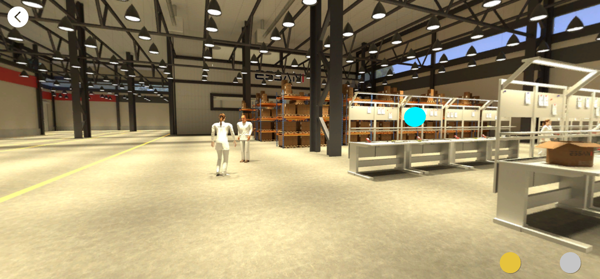
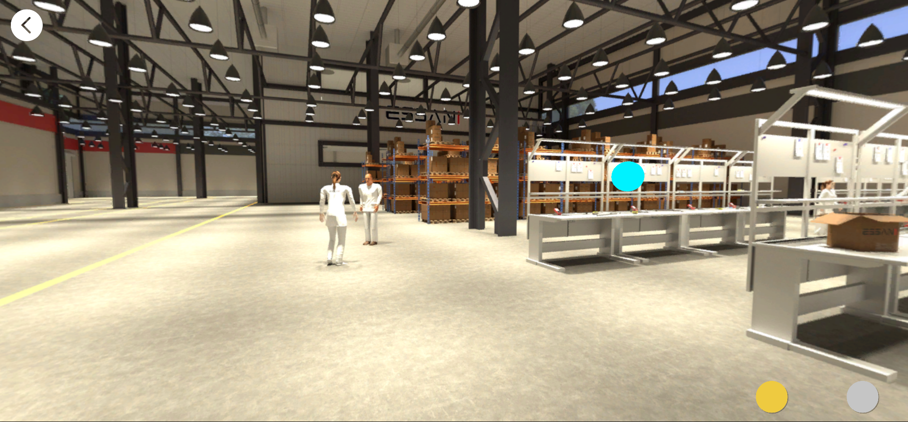
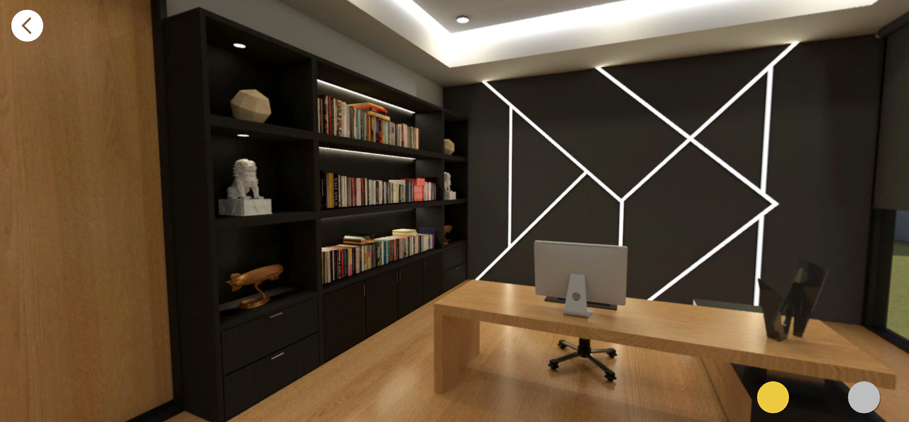
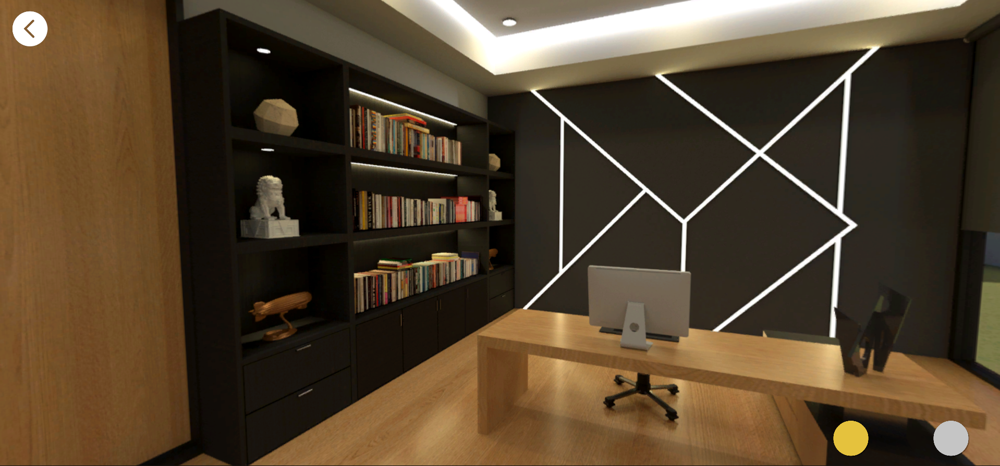
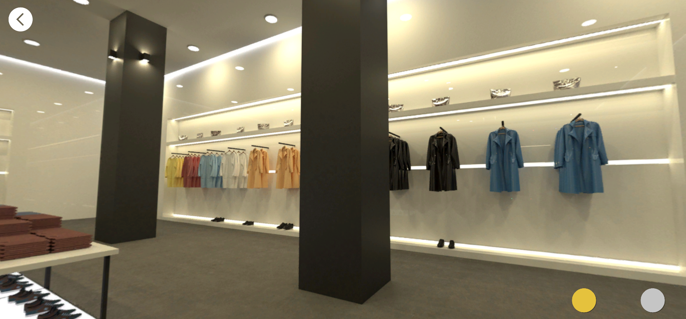
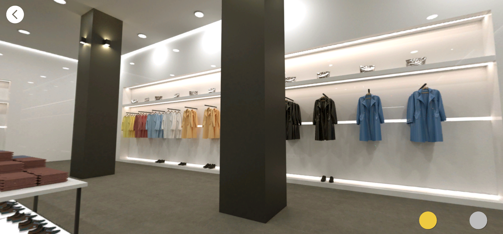

---
tags:
  - Unity
  - C#
  - WebGL
  - Optimization
---

# Essani

**Role:** Unity Developer

## Client
Essani specializes in custom lighting products and services for the furniture and architecture industries, and for industrial automation.

- [LinkedIn](https://www.linkedin.com/company/essani-inovação-tecnológica/)
- [Website](https://essani.pt)

## Overview
A WebGL lighting configurator. Users explore 360° environments (a factory, a house and a store) and switch between lighting setups, with the scene updating to match the selected lighting.

## Challenge
Build size and load time. WebGL apps are downloaded in the browser, and the high-resolution 360° images made the build heavy.

## What I Did
- Audited the image assets and found many were imported at far higher quality than the screen could show.
- Halving the quality on those assets **significantly reduced the build size** and made the app run more smoothly, with almost no visible difference.

## Try It
- [Play the WebGL build](https://kronoustech.github.io/PortfolioProject-Essani/)

## Media

  <button class="prev" aria-label="Previous image">&larr;</button>
  
  
  
  
  
  
  <button class="next" aria-label="Next image">&rarr;</button>
  

