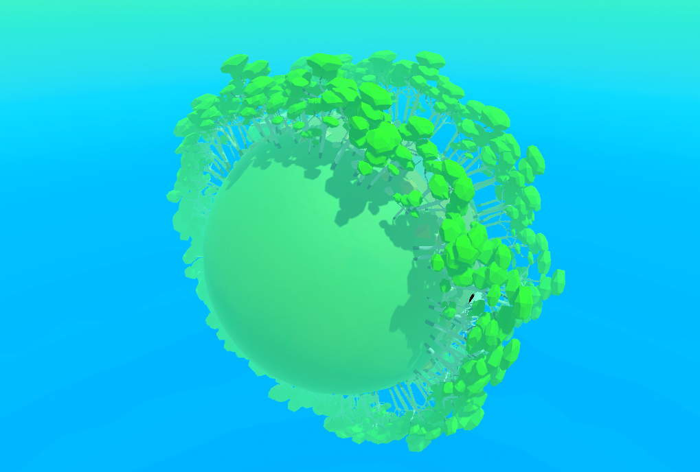
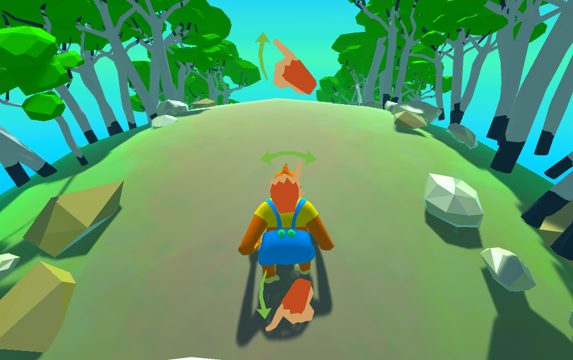
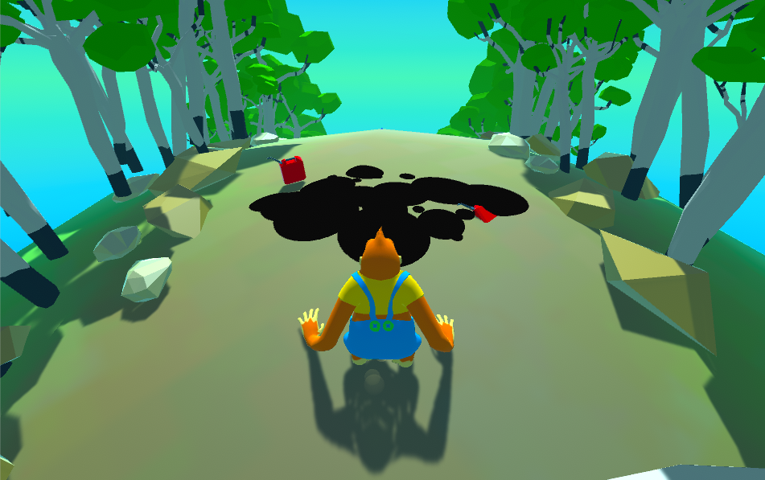

---
tags:
  - Unity
  - C#
  - Game
  - Android
  - iOS
  - Procedural Generation
---

# Gold Energy

**Role:** Unity Developer

## Client
Goldenergy is a Portuguese energy supplier offering electricity and gas plans to homes and businesses.

- [LinkedIn](https://www.linkedin.com/company/goldenergy/)

## Overview
A small branded endless runner starring Goldy, the company's gorilla mascot, built in **three days**. Inspired by games like Subway Surfers, the player moves side to side, jumps and rolls to dodge rolling tree trunks around a spherical world.

## Challenge
A tight three-day deadline, plus a procedural obstacle system that had to work on a spherical track.

## What I Did
- **Planned the work** into small, prioritised tasks to ship on time.
- **Procedural obstacles:** spawned obstacles with the correct position and rotation on the curved world, spaced so they never overlap.
- **Object pooling:** recycled obstacles once the player passed them, instead of creating and destroying them, which kept performance steady on mobile.

## Media

  <button class="prev" aria-label="Previous image">&larr;</button>
  
  
  
  <button class="next" aria-label="Next image">&rarr;</button>
  

