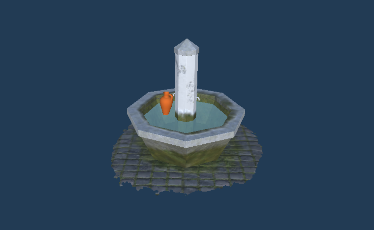
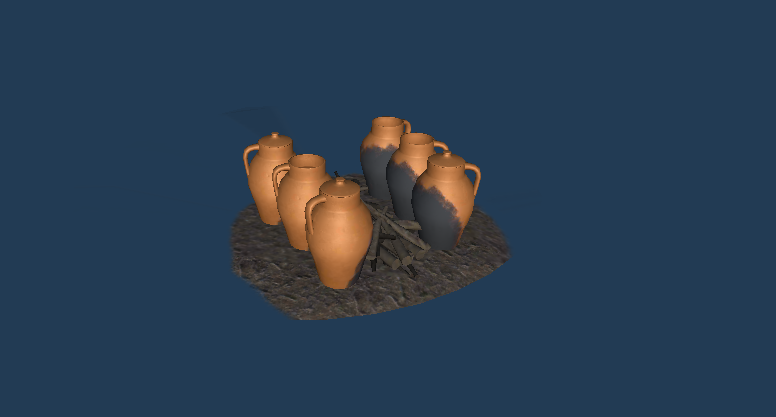
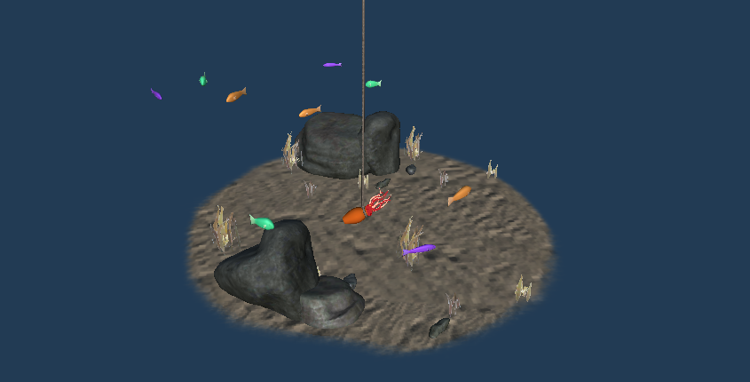
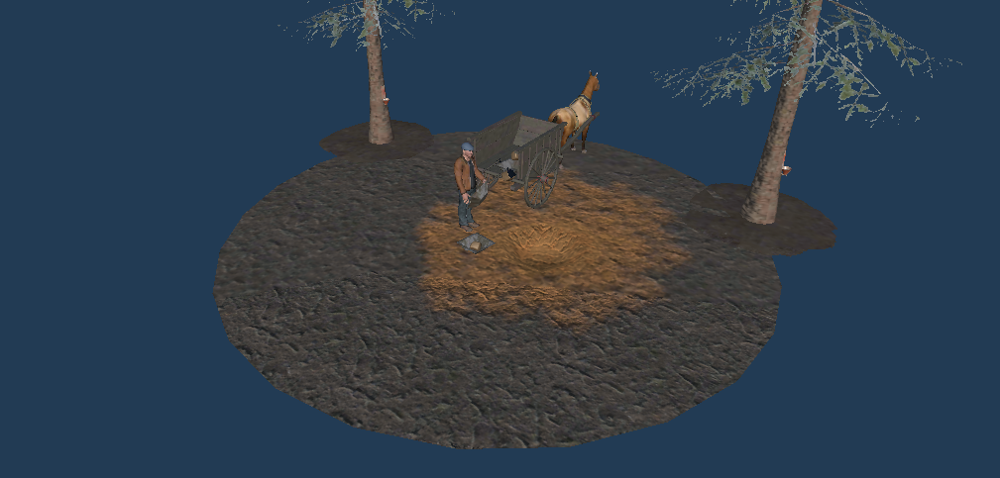

---
tags:
  - Unity
  - C#
  - AR
  - Android
  - iOS
---

# Grândola AR

**Role:** Unity Developer

## Client
Grândola Municipality (Câmara Municipal de Grândola).

## Overview
A marker-based AR app with animated scenes about the pottery process and Grândola's traditional culture.

## Challenge
Keeping the AR content stable. When marker tracking flickered for a moment, models would disappear and pop back in, which broke the experience.

## What I Did
- Added a **tracking grace period**: when a marker is lost, the model stays at its last known pose for 3 seconds before hiding.
- This removed the flicker caused by brief tracking drops while still hiding content when the marker was really gone.

## Media

  <button class="prev" aria-label="Previous image">&larr;</button>
  
  
  
  
  <button class="next" aria-label="Next image">&rarr;</button>
  

### Part 1
<video controls preload="metadata" width="100%">
  <source src="../../../../content/projects/hivolve/grandola-ar/grandola_ar_part_1.mp4" type="video/mp4">
</video>

### Part 2
<video controls preload="metadata" width="100%">
  <source src="../../../../content/projects/hivolve/grandola-ar/grandola_ar_part_2.mp4" type="video/mp4">
</video>
