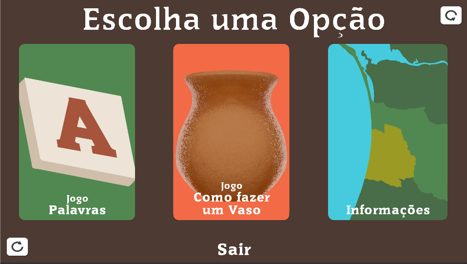
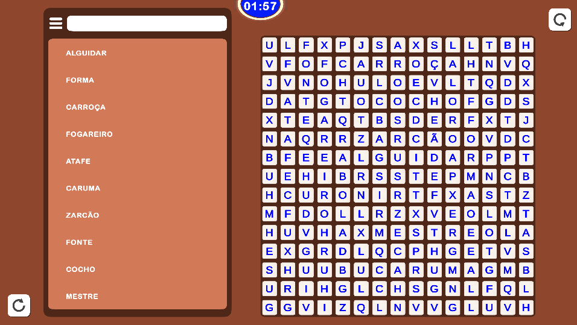
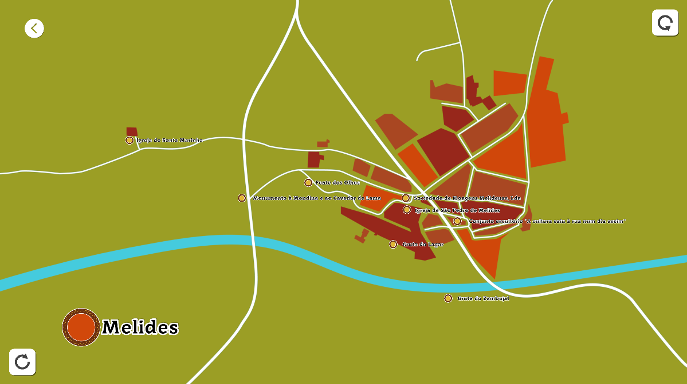
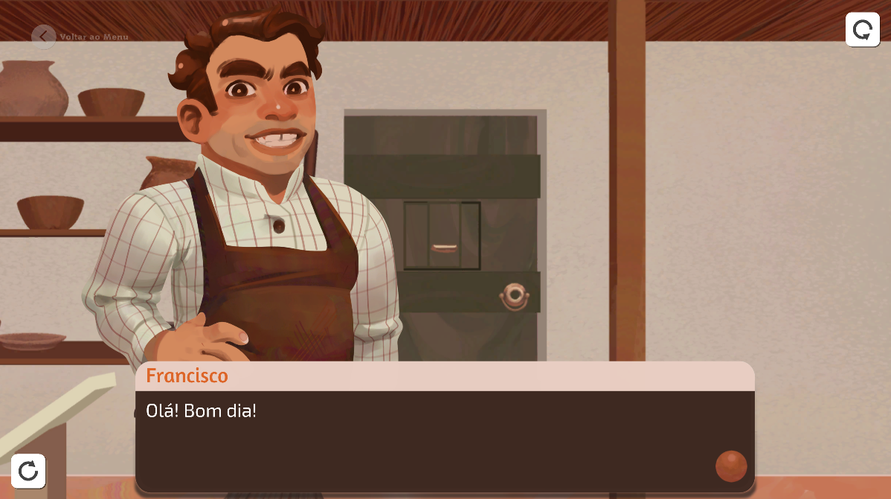

---
tags:
  - Unity
  - C#
  - Game
  - Android
  - iOS
  - Procedural Generation
---

# Grândola Mupi

**Role:** Unity Developer

## Client
Grândola Municipality (Câmara Municipal de Grândola).

## Overview
A set of short educational games for an interactive *mupi* (a public touchscreen kiosk), all centred on Melides pottery: a clay game, an info game and a word search.

## Challenge
The word search had to generate a new, valid puzzle every time, with words allowed to share letters where they cross.

## What I Did
I wrote a procedural word-search generator:

1. For each word, pick a random direction (horizontal or vertical) and a valid start position for the word's length.
2. Walk the cells: each one must be empty or already hold the same letter, so words can cross.
3. If a placement fails, try a new position. After repeated failures, reset the grid and regenerate.
4. Size the grid slightly larger than the longest word, which makes resets very rare in practice.
5. Fill the remaining cells with random letters and render the grid.

## Media

  <button class="prev" aria-label="Previous image">&larr;</button>
  
  
  
  
  <button class="next" aria-label="Next image">&rarr;</button>
  

### Clay Game
<video controls preload="metadata" width="100%">
  <source src="../../../../content/projects/hivolve/grandola-mupi/barro.mp4" type="video/mp4">
</video>

### Info Game
<video controls preload="metadata" width="100%">
  <source src="../../../../content/projects/hivolve/grandola-mupi/info.mp4" type="video/mp4">
</video>

### Word Search Game
<video controls preload="metadata" width="100%">
  <source src="../../../../content/projects/hivolve/grandola-mupi/words.mp4" type="video/mp4">
</video>
