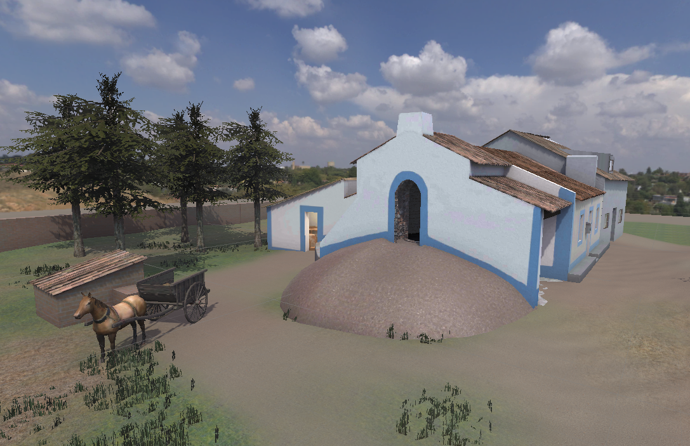
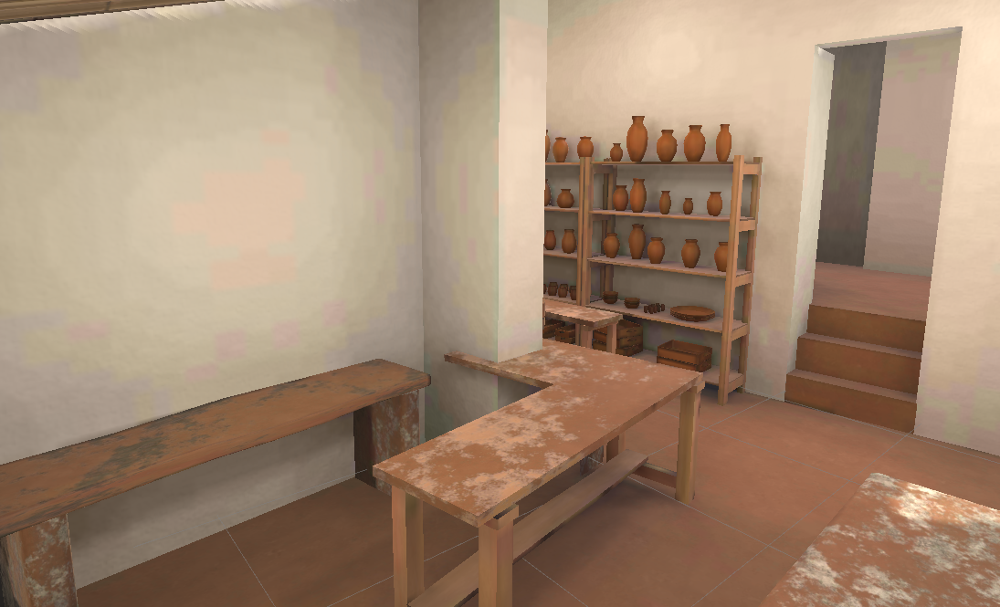
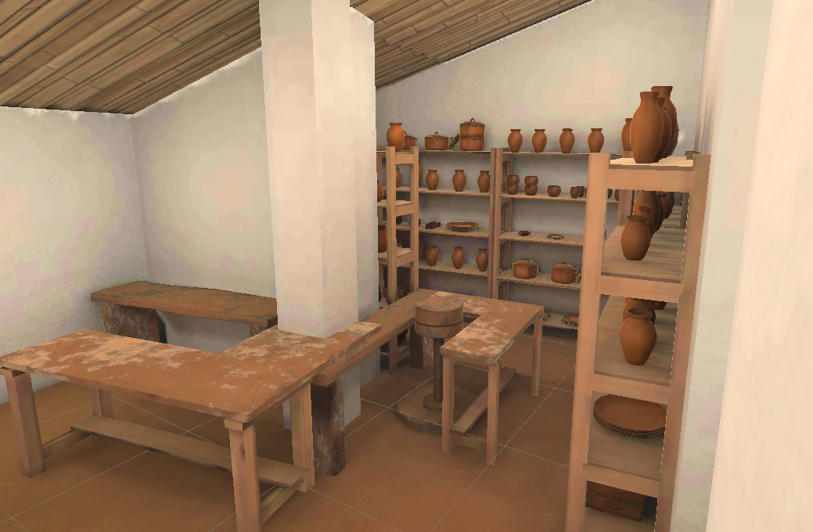
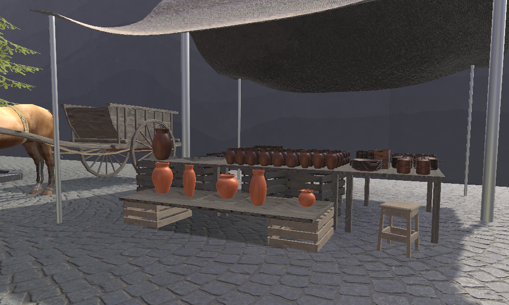

---
tags:
  - Unity
  - C#
  - VR
---

# Grândola VR

**Role:** Unity Developer

## Client
Grândola Municipality (Câmara Municipal de Grândola).

## Overview
A VR experience about the traditional craft of making clay pots. Players go through every step themselves, from gathering raw clay to shaping and finally selling the finished pot.

## Challenge
It is a long, guided experience made of many sequential tasks. Each task needed a clear completion condition, visual cues to guide the player, and visual or audio feedback when it was done.

## What I Did
- Designed a **task system**: a manager that runs all the tasks in a scene and advances to the next one when the current task completes.
- Built it on an **abstract task base class**, so each new task type plugs in with its own condition, hints and feedback while sharing the same flow.

## Media

  <button class="prev" aria-label="Previous image">&larr;</button>
  
  
  
  
  <button class="next" aria-label="Next image">&rarr;</button>
  

### Part 1
<video controls preload="metadata" width="100%">
  <source src="../../../../content/projects/hivolve/grandola-vr/part_1.mp4" type="video/mp4">
</video>

### Part 2
<video controls preload="metadata" width="100%">
  <source src="../../../../content/projects/hivolve/grandola-vr/part_2.mp4" type="video/mp4">
</video>

### Part 3
<video controls preload="metadata" width="100%">
  <source src="../../../../content/projects/hivolve/grandola-vr/part_3.mp4" type="video/mp4">
</video>
