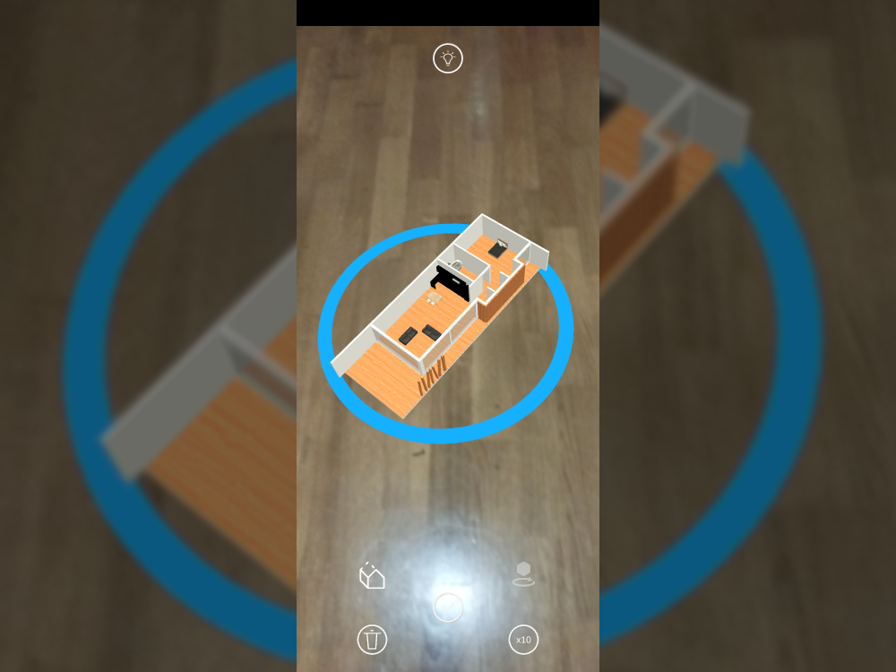
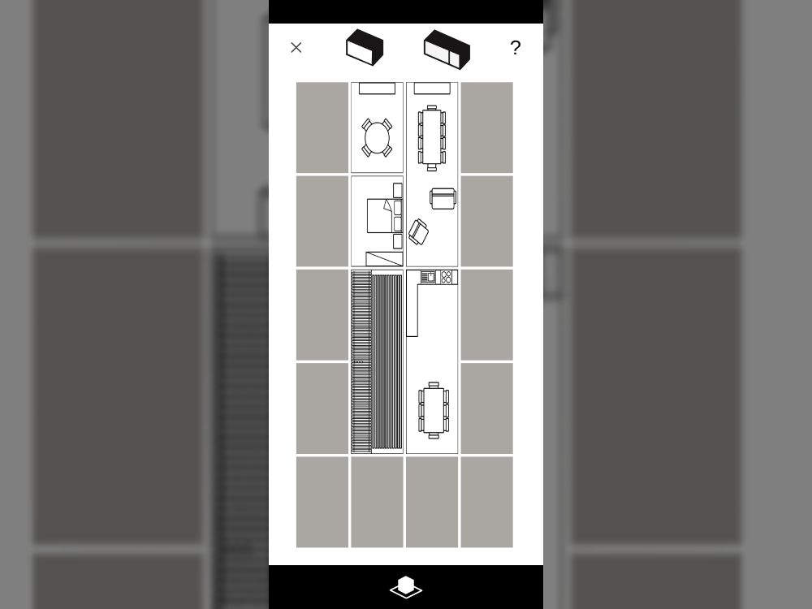
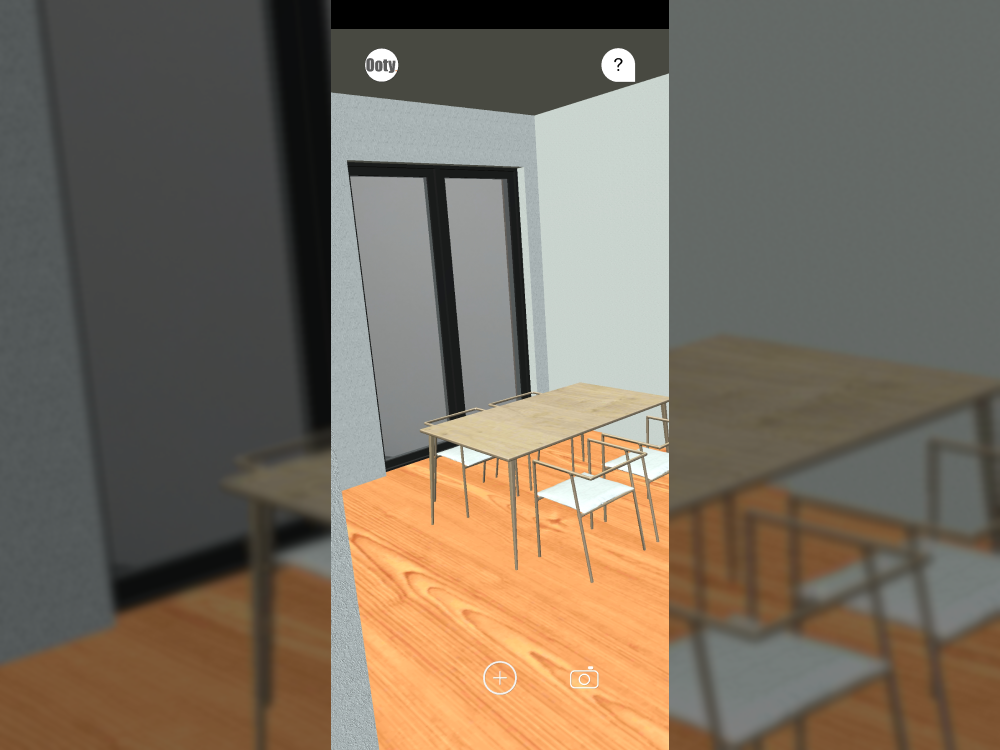

---
tags:
  - Unity
  - C#
  - AR
  - ARKit
  - ARCore
  - Android
  - iOS
---

# Ooty AR

**Role:** Unity Developer

## Client
Ooty is a trademark of the Black Oak Company (now **Kōzōwood Industries**), which builds prefabricated and modular wooden structures: houses, bungalows, accommodation modules, and commercial and tourism buildings.

- [LinkedIn](https://www.linkedin.com/company/kozowoodindustries/)
- [Website](https://kozowood.com)
- [Google Play](https://play.google.com/store/apps/details?id=com.hivolve.ooty)

## Overview
An augmented reality app for Android and iOS that showcases the client's product range. Users can:

- place houses at **real size** to walk around them, or **scale them down** for an overview,
- view interiors,
- design their own house in a **custom in-app house editor**.

## Challenge
The app had to run on both iOS and Android, which meant supporting two different AR frameworks, ARKit and ARCore, in a single Unity project.

## What I Did
- Studied both SDKs in depth and identified the minimal set of components each one needed.
- Integrated both into the same scene and adjusted them to coexist without conflicts.
- Wrote a platform-detection layer that enables the right framework for iOS or Android.

## Media

  <button class="prev" aria-label="Previous image">&larr;</button>
  
  
  
  
  <button class="next" aria-label="Next image">&rarr;</button>
  

### House Editor
<video controls preload="metadata" width="100%">
  <source src="../../../../content/projects/hivolve/ooty/video_1.mp4" type="video/mp4">
</video>

### House Showcase
<video controls preload="metadata" width="100%">
  <source src="../../../../content/projects/hivolve/ooty/video_2.mp4" type="video/mp4">
</video>
