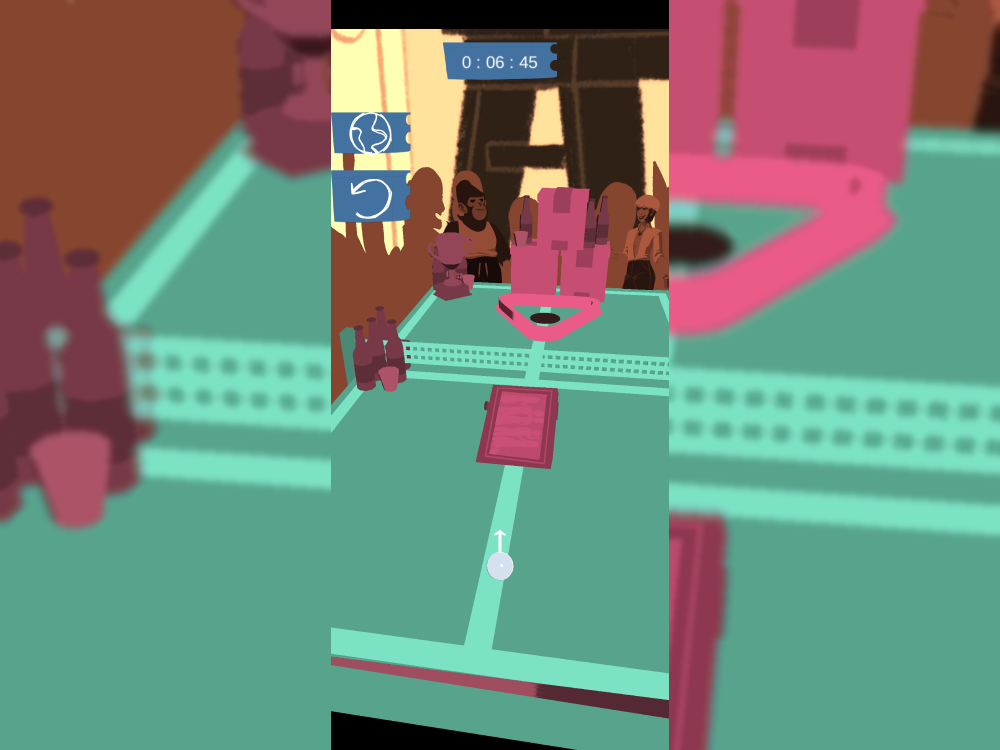
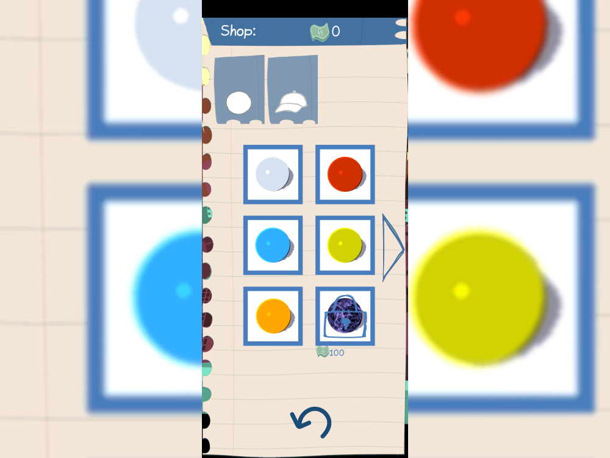

---
tags:
  - Unity
  - C#
  - Game
  - Android
  - iOS
---

# Party Golf

**Role:** Unity Developer (internship project)

## Overview
A party-themed mobile mini-golf game I built during my internship at hivolve, inspired by *Golf It*. It has level select, local multiplayer and an in-game shop.

## What I Did
- **Ball physics:** tuned the golf ball physics to feel right on a phone.
- **Touch controls:** designed aiming and shooting for touchscreens.
- **Monetization:** integrated mobile ads.
- **Optimization:** my first pass at optimizing a game for mobile hardware.

As my first mobile game, it set the foundation for the mobile input, physics, ads and optimization work in my later projects.

## Media

  <button class="prev" aria-label="Previous image">&larr;</button>
  
  
  
  
  
  <button class="next" aria-label="Next image">&rarr;</button>
  

### Gameplay
<video controls preload="metadata" width="100%">
  <source src="../../../../content/projects/hivolve/party-golf/gameplay_showcase.mp4" type="video/mp4">
</video>
