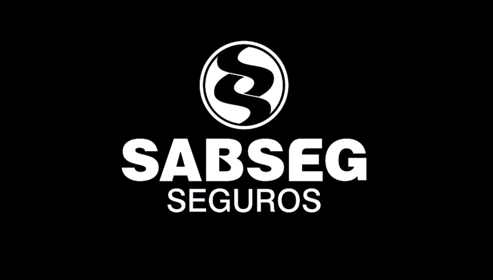

---
tags:
  - Unity
  - C#
  - VR
  - SteamVR
  - Game
---

# Sabseg VR

**Role:** Unity Developer

## Client
SABSEG is an insurance broker that sponsors several clubs in Portugal's first and second football divisions. For its *Celebrate Football* initiative, hivolve created a VR brand activation that ran in the stadiums of the sponsored clubs.

- [LinkedIn](https://www.linkedin.com/company/sabseg/)

## Overview
A VR penalty-saving game. The player is the goalkeeper and tries to stop penalties, with a reward for each save. We built several football stadiums, different player scenarios and dynamic weather conditions.

## Technologies
SteamVR Plugin.

## What I Did
- This was my first VR project. I got up to speed with SteamVR by studying its documentation and taking apart its example scenes.
- Used that knowledge to build the VR goalkeeping gameplay on top of the plugin.

## Media

  <button class="prev" aria-label="Previous image">&larr;</button>
  
  <button class="next" aria-label="Next image">&rarr;</button>
  

### Promotion Video
<video controls preload="metadata" width="100%">
  <source src="../../../../content/projects/hivolve/sabseg/Intro.mp4" type="video/mp4">
</video>
