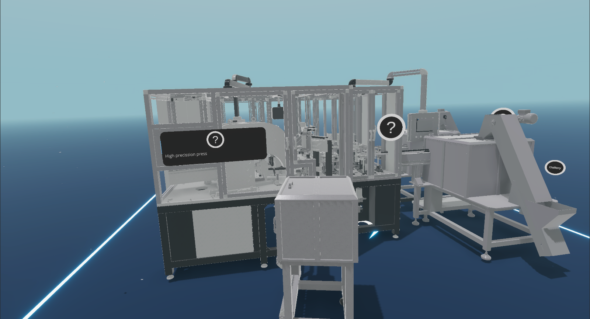
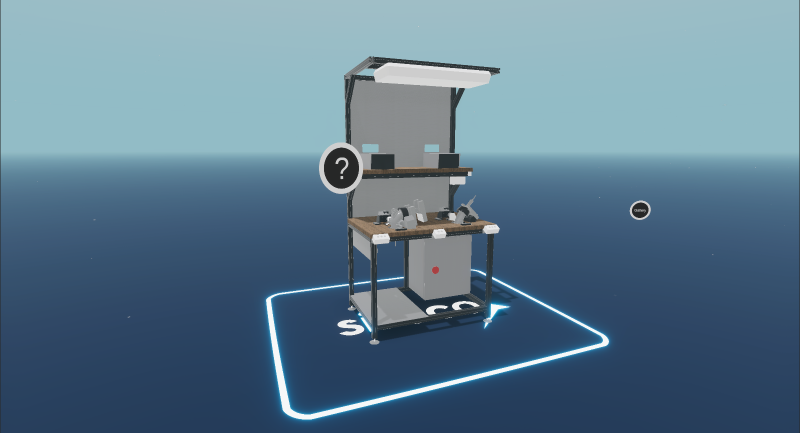
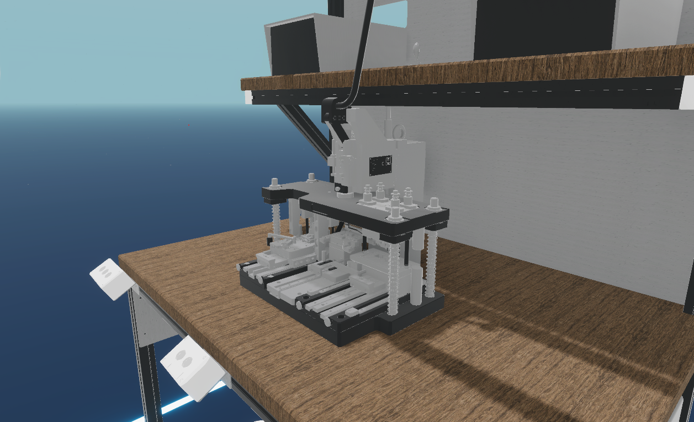
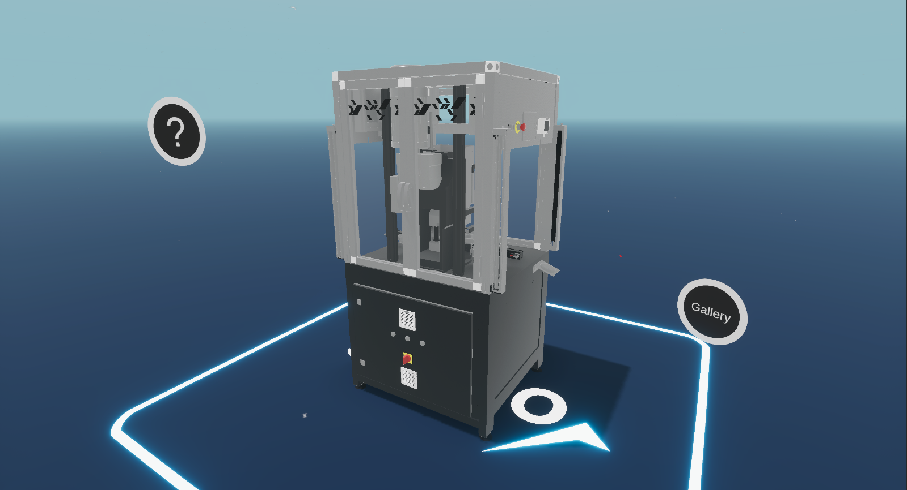
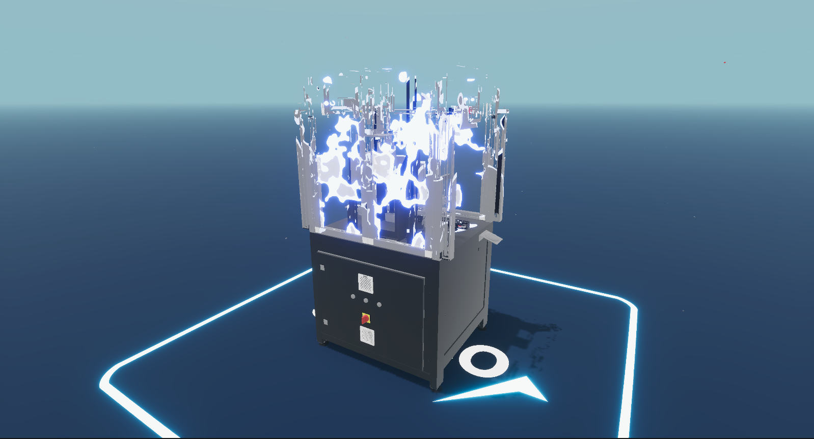

---
tags:
  - Unity
  - C#
  - VR
  - Android
  - Shaders
  - Optimization
---

# Siroco VR

**Role:** Unity Developer

## Client
Siroco designs innovative engineering solutions and produces high-precision mechanical parts and tools in small series.

- [LinkedIn](https://www.linkedin.com/company/sirocopt/)

## Overview
A VR showroom that presents the client's machines in high detail, along with the technical information for each one. It started on HTC Vive with the SteamVR plugin and later moved to the Oculus SDK.

## Challenge
The machine models were very detailed, and showing them while holding a stable VR frame rate was hard.

## What I Did
- Changed the presentation to show **one machine at a time**, which kept rendering cost under control.
- Wrote a custom **dissolve shader** to transition between machines, which turned the constraint into a polished part of the experience (see the video below).

## Media

  <button class="prev" aria-label="Previous image">&larr;</button>
  
  
  
  
  
  <button class="next" aria-label="Next image">&rarr;</button>
  

### Machine Transition (dissolve shader)
<video controls preload="metadata" width="100%">
  <source src="../../../../content/projects/hivolve/siroco/transition.mp4" type="video/mp4">
</video>
