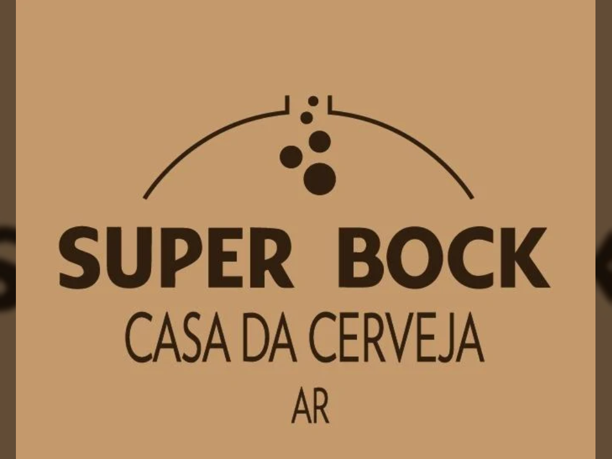

---
tags:
  - Unity
  - C#
  - AR
  - Android
  - iOS
---

# Super Bock Casa da Cerveja AR

**Role:** Unity Developer

## Client
Super Bock is Portugal's best-selling beer brand worldwide, produced by the Super Bock Group since 1927.

- [LinkedIn](https://www.linkedin.com/company/superbockgroup/)
- [Google Play](https://play.google.com/store/apps/details?id=com.YourCompany.SuperBockHouse)
- [App Store](https://apps.apple.com/us/app/casa-da-cerveja-ar/id1500622998)

## Overview
*Casa da Cerveja* is a visitor tour inside the Super Bock Group production centre. This AR app brings the group's original brewing room back to life, walking visitors through the whole process: raw materials, wort production, fermentation, and bottling.

## Challenge
The experience could only be tested on-site, in the museum. Placing 3D models accurately relative to the real room was slow and hard to iterate on.

## What I Did
- Built a **developer placement tool** that measured the device's position relative to the AR marker on-site and saved it.
- Used those saved positions back in the studio to place models in the scene. It wasn't perfect, but it made the initial layout much faster and simpler.

## Media

  <button class="prev" aria-label="Previous image">&larr;</button>
  
  <button class="next" aria-label="Next image">&rarr;</button>
  

