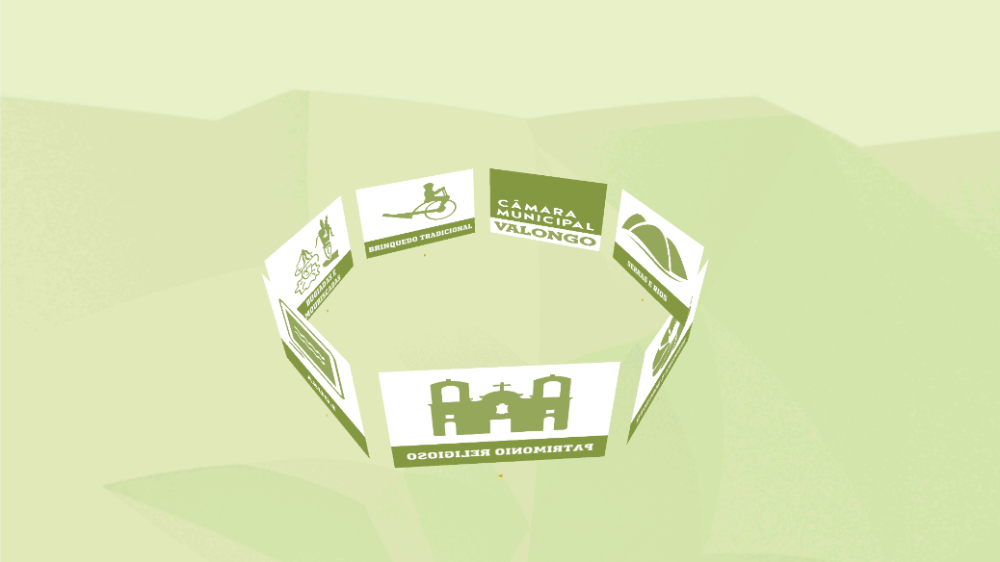
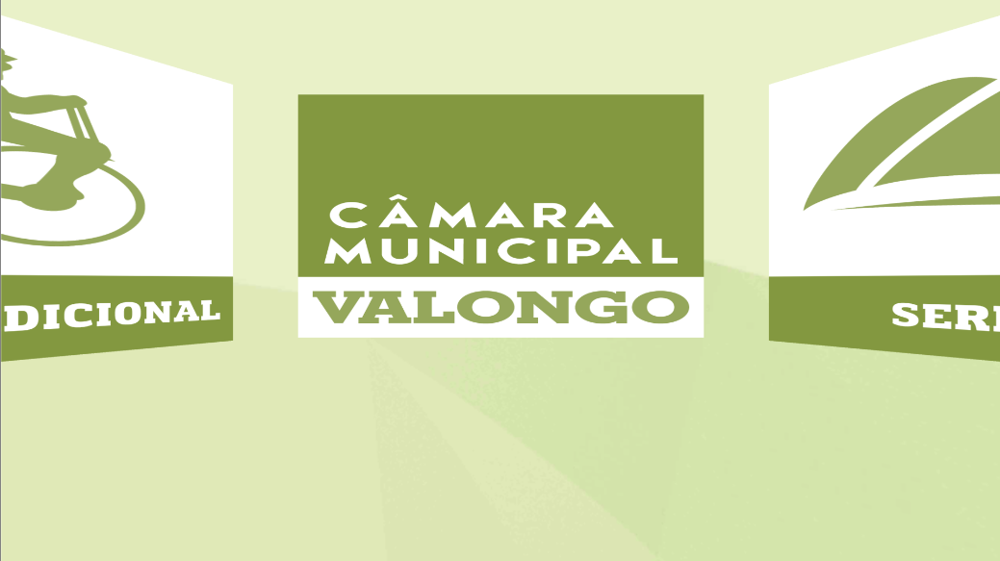

---
tags:
  - Unity
  - C#
  - VR
  - Android
---

# Valongo 360

**Role:** Unity Developer

## Client
Valongo Municipality (Câmara Municipal de Valongo).

## Overview
A VR tourism experience that presents the city's attractions and cultural highlights through a series of immersive 360° videos.

## What I Did
- Built the **360° video player**: a video player renders into a render texture, which is applied to the material of an inward-facing sphere around the viewer.

## Media

  <button class="prev" aria-label="Previous image">&larr;</button>
  
  
  <button class="next" aria-label="Next image">&rarr;</button>
  

