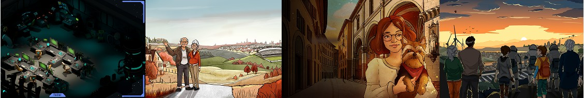

# KendirStudios

  

**2025 - Present · Unity Developer → Architecture Director**

A Porto-based studio that builds large, year-long educational role-playing games, spun off from *Schoolers & Scholars*, a research project on the impact of RPGs in education.

- [LinkedIn](https://www.linkedin.com/company/kendir-studios/)
- [Website](https://www.kendirstudios.pt/)

## My Experience
- Developed educational **games** in Unity for the Portuguese Directorate-General for Education (DGE).
- Promoted from **Unity Developer** to **Architecture Director**, taking on high-level planning and technical leadership.
- **Lead architectural planning** for upcoming projects, designing scalable, modular code structures.
- Built in-game content and internal tools as reusable **custom Unity packages** to streamline workflows.
- Established **development standards** and **best practices** for consistency and efficiency across teams.

## Projects
- [Farol](farol.md): Architecture Director
- [Reds 2, 3, 4](reds.md): Unity Developer
