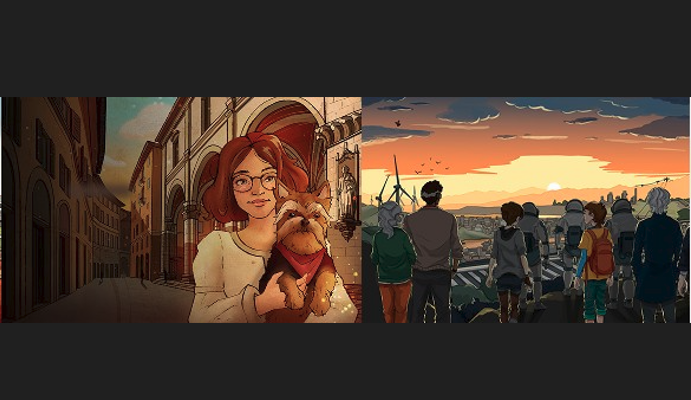
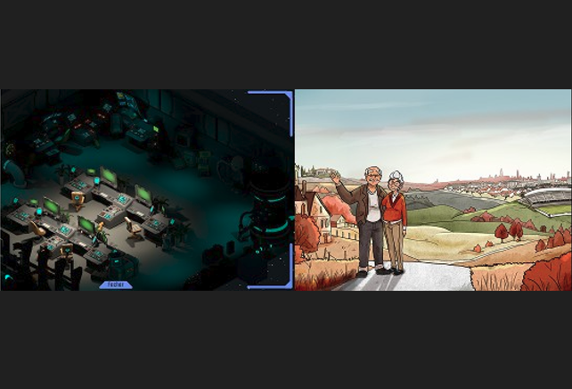

---
tags:
  - Unity
  - C#
  - WebGL
  - Game
---

# Reds 2, 3, 4

**Role:** Unity Developer

!!! info "Under NDA"
    I can't share details about the game itself yet. This page covers my contribution.

## My Contribution
When I joined KendirStudios, I worked on a release that was getting close to launch:

- **Features and content:** developed new gameplay features and game content.
- **Polish:** fixed bugs to get the product ready for launch.
- **Tooling:** created and reworked several internal tools, which noticeably sped up the team's development.

## Media

  <button class="prev" aria-label="Previous image">&larr;</button>
  
  
  <button class="next" aria-label="Next image">&rarr;</button>
  

